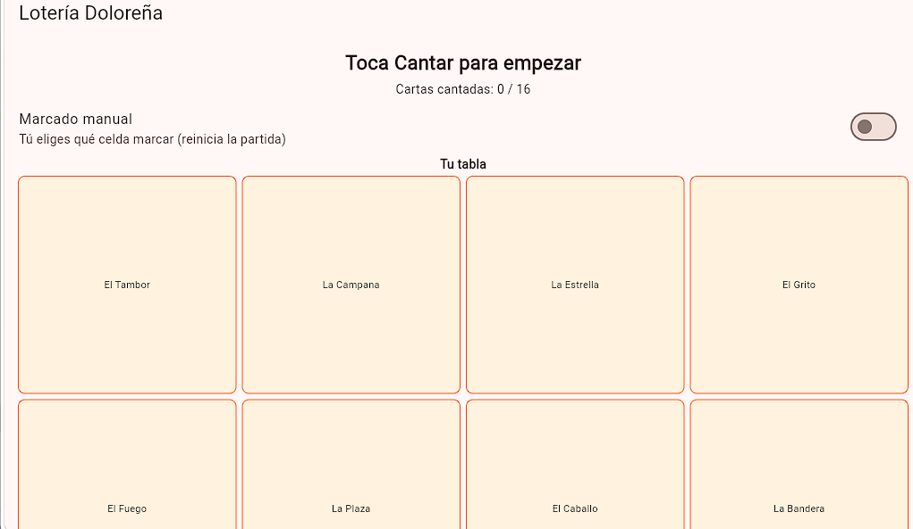
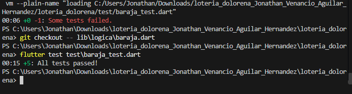
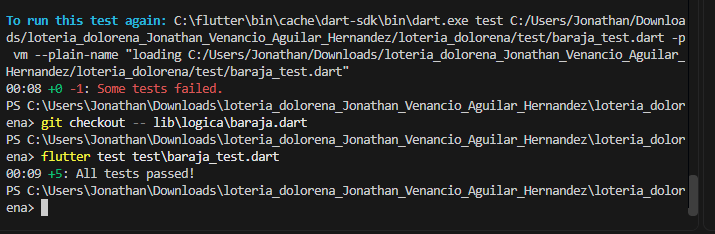
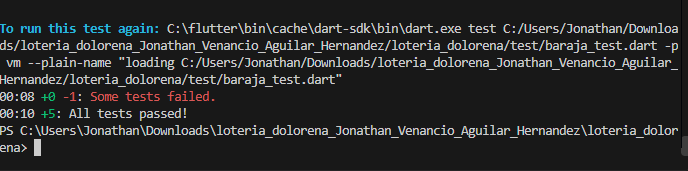
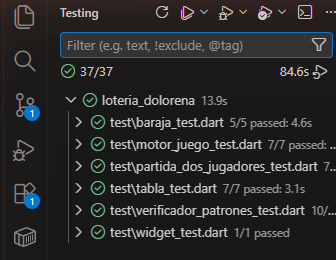

# Lotería Doloreña

Juego de lotería en Flutter con 16 cartas inspiradas en la Independencia y Dolores Hidalgo. Se desarrolló con TDD: cada regla del juego nació de una prueba, y la lógica vive separada de la interfaz para poder probarla sin abrir la app.

**Autor:** Jonathan Venancio Aguilar Hernandez

## Qué hace

- Baraja de 16 cartas (El Cura, La Campana, El Grito, La Parroquia, El Sarape, La Nieve, El Sombrero, La Guitarra, El Caballo, La Bandera, El Insurgente, La Plaza, El Fuego, La Estrella, El Águila, El Tambor) que se mezcla y se canta una por una.
- Tablas de 4x4 generadas al azar.
- Se gana con una línea, una columna o una diagonal. También se detecta la tabla llena.
- Marcado automático al cantar o marcado manual: en modo manual solo se puede marcar una carta que ya fue cantada.
- Segundo jugador simulado. Gana quien complete primero; si ambos lo hacen a la vez, hay empate.
- Contador de cartas cantadas (N / 16) y diálogo final con opción de jugar de nuevo.

## Pantalla de la app

Pantalla inicial: la carta por cantar, el contador de cartas (0 / 16), el interruptor de marcado manual y la tabla de 4x4.



## Arquitectura

La lógica es Dart puro, sin dependencias de Flutter, y la interfaz solo la consume.

| Capa | Archivos | Responsabilidad |
|---|---|---|
| Modelos | `lib/modelos/carta.dart` | `Carta` con `id` y `nombre`; la igualdad se define por `id` |
| Lógica | `lib/logica/baraja.dart` | Crear, mezclar y cantar cartas |
| | `lib/logica/tabla.dart` | Tabla 4x4, marcado y validación de cartas cantadas |
| | `lib/logica/verificador_patrones.dart` | Línea, columna, diagonal, ganador y tabla llena |
| | `lib/logica/motor_juego.dart` | Coordina baraja, tabla y marcado (automático o manual) |
| | `lib/logica/partida_dos_jugadores.dart` | Partida contra el jugador simulado y resultado final |
| Interfaz | `lib/main.dart` | Pantalla del juego en Material 3 |

## Estructura

```
loteria_dolorena/
├── lib/
│   ├── main.dart
│   ├── modelos/carta.dart
│   └── logica/
│       ├── baraja.dart
│       ├── tabla.dart
│       ├── verificador_patrones.dart
│       ├── motor_juego.dart
│       └── partida_dos_jugadores.dart
├── test/
│   ├── baraja_test.dart
│   ├── tabla_test.dart
│   ├── verificador_patrones_test.dart
│   ├── motor_juego_test.dart
│   ├── partida_dos_jugadores_test.dart
│   └── widget_test.dart
├── capturas/
└── pubspec.yaml
```

No usa paquetes externos: solo Flutter y `flutter_test`.

## Cómo ejecutarlo

Requiere Flutter (SDK `>=3.0.0 <4.0.0`).

```bash
git clone https://github.com/venancio377/Loteria.git
cd Loteria
flutter pub get
flutter run -d chrome
```

## Pruebas con TDD, ronda por ronda

Cada ronda sigue el ciclo del manual: primero una prueba que falla (🔴 rojo), luego el código mínimo para que pase (🟢 verde) y, si hace falta, un refactor (🔵). La lógica es Dart puro, así que todo se verifica con `flutter test` sin abrir un emulador.

Las capturas se tomaron sobre el proyecto terminado. Para ver el rojo se vacía o se recorta el archivo de `lib/logica/` que introduce esa ronda y se corre la prueba; después `git checkout` restaura el código y se vuelve a correr para el verde. Por eso cada captura trae las dos corridas, y como cada archivo de prueba reúne las pruebas de sus rondas, el verde cuenta todas las del archivo (5 en `baraja_test.dart`).

```powershell
Set-Content lib\logica\baraja.dart "// vacio"       # rojo: la clase Baraja no existe
flutter test test\baraja_test.dart
git checkout -- lib\logica\baraja.dart              # se restaura el código
flutter test test\baraja_test.dart                  # verde
```

### Ronda 1: la baraja completa

**Prueba** (`test/baraja_test.dart`):

```dart
test('crearBarajaCompleta regresa exactamente 16 cartas', () {
  final baraja = Baraja.crearBarajaCompleta();
  expect(baraja.cartasRestantes.length, 16);
});

test('crearBarajaCompleta no repite ninguna carta', () {
  final baraja = Baraja.crearBarajaCompleta();
  final idsUnicos = baraja.cartasRestantes.map((c) => c.id).toSet();
  expect(idsUnicos.length, 16);
});
```

🔴 **Rojo.** La clase `Baraja` todavía no existe, así que el archivo de pruebas no compila y la ejecución termina con `Some tests failed.`

**Código mínimo** (`lib/logica/baraja.dart`):

```dart
class Baraja {
  final List<Carta> cartasRestantes;
  Baraja._(this.cartasRestantes);

  static const List<String> _nombres = [
    'El Cura', 'La Campana', 'El Grito', 'La Parroquia',
    'El Sarape', 'La Nieve', 'El Sombrero', 'La Guitarra',
    'El Caballo', 'La Bandera', 'El Insurgente', 'La Plaza',
    'El Fuego', 'La Estrella', 'El Águila', 'El Tambor',
  ];

  static Baraja crearBarajaCompleta() {
    final cartas = <Carta>[];
    for (var i = 0; i < _nombres.length; i++) {
      cartas.add(Carta(id: i, nombre: _nombres[i]));
    }
    return Baraja._(cartas);
  }
}
```

🟢 **Verde.** Con la clase creada las pruebas pasan (`All tests passed!`).



### Ronda 2: barajar sin perder ni duplicar cartas

**Prueba** (`test/baraja_test.dart`):

```dart
test('mezclar conserva las mismas 16 cartas, solo cambia el orden', () {
  final baraja = Baraja.crearBarajaCompleta();
  final idsAntes = baraja.cartasRestantes.map((c) => c.id).toSet();
  baraja.mezclar();
  final idsDespues = baraja.cartasRestantes.map((c) => c.id).toSet();
  expect(idsDespues, idsAntes);
});
```

🔴 **Rojo.** `mezclar()` no está definido para `Baraja`; falla la compilación.

**Código mínimo** (`lib/logica/baraja.dart`):

```dart
void mezclar() => cartasRestantes.shuffle();
```

🟢 **Verde.** La prueba compara conjuntos de ids, no listas: no importa el orden nuevo, solo que sigan siendo las mismas 16 cartas.



### Ronda 3: cantar cartas, una por una

**Pruebas** (`test/baraja_test.dart`):

```dart
test('cantarSiguiente entrega una carta y la retira del mazo', () {
  final baraja = Baraja.crearBarajaCompleta();
  final total = baraja.cartasRestantes.length;
  final primera = baraja.cantarSiguiente();
  expect(primera, isNotNull);
  expect(baraja.cartasRestantes.length, total - 1);
});

test('cantarSiguiente regresa null cuando ya no hay cartas', () {
  final baraja = Baraja.crearBarajaCompleta();
  for (var i = 0; i < 16; i++) {
    baraja.cantarSiguiente();
  }
  expect(baraja.cantarSiguiente(), isNull);
});
```

🔴 **Rojo.** `cantarSiguiente()` no existe.

**Código mínimo** (`lib/logica/baraja.dart`):

```dart
Carta? cantarSiguiente() {
  if (cartasRestantes.isEmpty) return null;
  return cartasRestantes.removeAt(0);
}
```

🟢 **Verde.** Pasan las cinco pruebas del archivo.



🔵 **Refactor.** `removeAt(0)` desplaza todos los elementos de la lista. Como la baraja ya viene mezclada, el orden no importa y se puede quitar del final con `removeLast()`, que es más eficiente. Las pruebas no cambian y siguen en verde; es la versión que quedó en `lib/logica/baraja.dart`.

```dart
Carta? cantarSiguiente() {
  if (cartasRestantes.isEmpty) return null;
  return cartasRestantes.removeLast();
}
```

### Ronda 4: la tabla, una cuadrícula de 4x4

**Pruebas** (`test/tabla_test.dart`):

```dart
test('una tabla nueva contiene las 16 cartas, sin repetir', () {
  final cartas = Baraja.crearBarajaCompleta().cartasRestantes;
  final tabla = Tabla.generar(cartas);
  final todas = tabla.filas.expand((fila) => fila).toList();
  expect(todas.length, 16);
  expect(todas.toSet().length, 16);
});

test('una tabla nueva no tiene ninguna celda marcada', () {
  final cartas = Baraja.crearBarajaCompleta().cartasRestantes;
  final tabla = Tabla.generar(cartas);
  expect(tabla.marcadas.every((fila) => fila.every((m) => m == false)), true);
});
```

🔴 **Rojo.** La clase `Tabla` no existe.

**Código mínimo** (`lib/logica/tabla.dart`):

```dart
class Tabla {
  final List<List<Carta>> filas;
  final List<List<bool>> marcadas;
  Tabla._(this.filas, this.marcadas);

  static Tabla generar(List<Carta> cartas) {
    final copia = List<Carta>.from(cartas)..shuffle();
    final filas = <List<Carta>>[];
    for (var f = 0; f < 4; f++) {
      filas.add(copia.sublist(f * 4, f * 4 + 4));
    }
    final marcadas = List.generate(4, (_) => List.generate(4, (_) => false));
    return Tabla._(filas, marcadas);
  }
}
```

🟢 **Verde.** La tabla trae las 16 cartas sin repetir y ninguna celda marcada.

### Ronda 5: marcar una carta en la tabla

**Pruebas** (`test/tabla_test.dart`):

```dart
test('marcar encuentra la carta en la tabla y marca su celda', () {
  final cartas = Baraja.crearBarajaCompleta().cartasRestantes;
  final tabla = Tabla.generar(cartas);
  final cartaEnTabla = tabla.filas[0][0];

  tabla.marcar(cartaEnTabla);

  expect(tabla.marcadas[0][0], true);
});

test('marcar una carta que no esta en la tabla no cambia nada', () {
  final cartas = Baraja.crearBarajaCompleta().cartasRestantes;
  final tabla = Tabla.generar(cartas);
  const cartaAjena = Carta(id: 999, nombre: 'Carta inexistente');

  tabla.marcar(cartaAjena);

  expect(tabla.marcadas.every((fila) => fila.every((m) => m == false)), true);
});
```

🔴 **Rojo.** `marcar()` no existe.

**Código mínimo** (`lib/logica/tabla.dart`):

```dart
void marcar(Carta carta) {
  for (var f = 0; f < filas.length; f++) {
    for (var c = 0; c < filas[f].length; c++) {
      if (filas[f][c] == carta) {
        marcadas[f][c] = true;
        return;
      }
    }
  }
}
```

🟢 **Verde.** Funciona porque `Carta` sobrescribe `==` para comparar por `id`; sin eso, dos objetos distintos nunca serían iguales.

### Ronda 6: detectar una línea horizontal

**Pruebas** (`test/verificador_patrones_test.dart`):

```dart
test('detecta una linea horizontal completa', () {
  final marcadas = [
    [true, true, true, true],
    [false, false, false, false],
    [false, false, false, false],
    [false, false, false, false],
  ];
  expect(VerificadorPatrones.hayLinea(marcadas), true);
});

test('no detecta linea si ninguna fila esta completa', () {
  final marcadas = [
    [true, true, true, false],
    [false, false, false, false],
    [false, false, false, false],
    [false, false, false, false],
  ];
  expect(VerificadorPatrones.hayLinea(marcadas), false);
});
```

🔴 **Rojo.** `VerificadorPatrones` no existe.

**Código mínimo** (`lib/logica/verificador_patrones.dart`):

```dart
class VerificadorPatrones {
  static bool hayLinea(List<List<bool>> marcadas) {
    for (final fila in marcadas) {
      if (fila.every((m) => m)) return true;
    }
    return false;
  }
}
```

🟢 **Verde.** Detecta la fila completa y descarta la incompleta.

### Ronda 7: detectar una columna

**Pruebas** (`test/verificador_patrones_test.dart`):

```dart
test('detecta una columna vertical completa', () {
  final marcadas = [
    [true, false, false, false],
    [true, false, false, false],
    [true, false, false, false],
    [true, false, false, false],
  ];
  expect(VerificadorPatrones.hayColumna(marcadas), true);
});

test('no detecta columna si ninguna esta completa', () {
  final marcadas = [
    [true, false, false, false],
    [true, false, false, false],
    [false, false, false, false],
    [true, false, false, false],
  ];
  expect(VerificadorPatrones.hayColumna(marcadas), false);
});
```

🔴 **Rojo.** `hayColumna()` no existe.

**Código mínimo** (`lib/logica/verificador_patrones.dart`):

```dart
static bool hayColumna(List<List<bool>> marcadas) {
  for (var c = 0; c < marcadas[0].length; c++) {
    var completa = true;
    for (var f = 0; f < marcadas.length; f++) {
      if (!marcadas[f][c]) {
        completa = false;
        break;
      }
    }
    if (completa) return true;
  }
  return false;
}
```

🟢 **Verde.** Pasan la columna completa y la que le falta una celda.

### Ronda 8: detectar una diagonal

**Pruebas** (`test/verificador_patrones_test.dart`):

```dart
test('detecta la diagonal principal completa', () {
  final marcadas = [
    [true, false, false, false],
    [false, true, false, false],
    [false, false, true, false],
    [false, false, false, true],
  ];
  expect(VerificadorPatrones.hayDiagonal(marcadas), true);
});

test('detecta la diagonal secundaria completa', () {
  final marcadas = [
    [false, false, false, true],
    [false, false, true, false],
    [false, true, false, false],
    [true, false, false, false],
  ];
  expect(VerificadorPatrones.hayDiagonal(marcadas), true);
});
```

🔴 **Rojo.** `hayDiagonal()` no existe.

**Código mínimo** (`lib/logica/verificador_patrones.dart`):

```dart
static bool hayDiagonal(List<List<bool>> marcadas) {
  final n = marcadas.length;
  var principal = true;
  var secundaria = true;
  for (var i = 0; i < n; i++) {
    if (!marcadas[i][i]) principal = false;
    if (!marcadas[i][n - 1 - i]) secundaria = false;
  }
  return principal || secundaria;
}
```

🟢 **Verde.** Detecta las dos diagonales.

🔵 **Refactor.** Línea, columna y diagonal siempre se usan juntas para decidir si hay lotería, así que se agrega un método combinado sin borrar los anteriores:

```dart
static bool hayGanador(List<List<bool>> marcadas) {
  return hayLinea(marcadas) || hayColumna(marcadas) || hayDiagonal(marcadas);
}
```

### Ronda 9: preparar el juego para probarlo

Esta ronda no agrega una regla nueva. Para probar "se cantan 4 cartas y se gana" hace falta controlar el orden de la baraja y el acomodo de la tabla, y hasta aquí ambos se mezclan siempre al azar. La solución es agregar constructores con nombre que reciben el orden exacto; el juego real sigue mezclando.

🔴 **Rojo (conceptual).** La prueba de integración de la ronda 10 sería aleatoria e inútil con el diseño anterior.

**Código mínimo:**

```dart
// lib/logica/baraja.dart
Baraja.desdeCartas(List<Carta> cartas)
    : cartasRestantes = List<Carta>.from(cartas);

// lib/logica/tabla.dart
Tabla.desdeFilas(this.filas)
    : marcadas = List.generate(4, (_) => List.generate(4, (_) => false));
```

🟢 **Verde.** Las pruebas anteriores siguen pasando sin cambios.

### Ronda 10: el motor de juego

**Pruebas** (`test/motor_juego_test.dart`):

```dart
MotorJuego _motorOrdenado() {
  final cartas = Baraja.crearBarajaCompleta().cartasRestantes; // orden fijo
  final baraja = Baraja.desdeCartas(cartas);
  final tabla = Tabla.desdeFilas([
    cartas.sublist(0, 4),
    cartas.sublist(4, 8),
    cartas.sublist(8, 12),
    cartas.sublist(12, 16),
  ]);
  return MotorJuego(baraja: baraja, tabla: tabla);
}

test('el motor detecta Loteria al completar una fila', () {
  final motor = _motorOrdenado();
  // cantarSiguiente() usa removeLast(): canta primero las ultimas 4 cartas,
  // que son exactamente la fila 3 de la tabla.
  for (var i = 0; i < 4; i++) {
    motor.cantarYMarcar();
  }
  expect(motor.haGanado, true);
});

test('el motor NO reporta Loteria si aun no se completa ningun patron', () {
  final motor = _motorOrdenado();
  motor.cantarYMarcar();
  motor.cantarYMarcar();
  expect(motor.haGanado, false);
});
```

🔴 **Rojo.** `MotorJuego` no existe.

**Código mínimo** (`lib/logica/motor_juego.dart`):

```dart
class MotorJuego {
  final Baraja baraja;
  final Tabla tabla;
  bool haGanado = false;

  MotorJuego({required this.baraja, required this.tabla});

  Carta? cantarYMarcar() {
    final carta = baraja.cantarSiguiente();
    if (carta == null) return null;
    tabla.marcar(carta);

    if (VerificadorPatrones.hayGanador(tabla.marcadas)) {
      haGanado = true;
    }
    return carta;
  }
}
```

🟢 **Verde.** El motor no reimplementa nada: solo orquesta la baraja, la tabla y el verificador, que ya estaban probados por separado.

## Retos de extensión

Después de las 10 rondas se agregaron los retos del manual, cada uno con su prueba antes que su código:

- **Tabla llena:** `VerificadorPatrones.tablaLlena()` detecta las 16 celdas marcadas como un premio distinto a la línea.
- **Contador:** `MotorJuego.totalCantadas` cuenta las cartas cantadas y la pantalla lo muestra (N / 16).
- **Marcado manual:** `Tabla.marcarSiCantada()` solo acepta una celda cuya carta ya fue cantada; un marcado incorrecto no cuenta.
- **Segundo jugador:** `PartidaDosJugadores` pone dos tablas sobre la misma baraja; gana quien complete un patrón primero y, si ambos lo hacen a la vez, hay empate.

## Resultado final

```bash
flutter test
```

**37 de 37 pruebas aprobadas.**



| Archivo | Pruebas | Qué cubre |
|---|---|---|
| `baraja_test.dart` | 5 | Cartas, mezcla y canto |
| `tabla_test.dart` | 7 | Generación y marcado |
| `verificador_patrones_test.dart` | 10 | Línea, columna, diagonal y tabla llena |
| `motor_juego_test.dart` | 7 | Canto, marcado automático y manual |
| `partida_dos_jugadores_test.dart` | 7 | Ganador, empate y jugador simulado |
| `widget_test.dart` | 1 | La partida se muestra y permite cantar |
